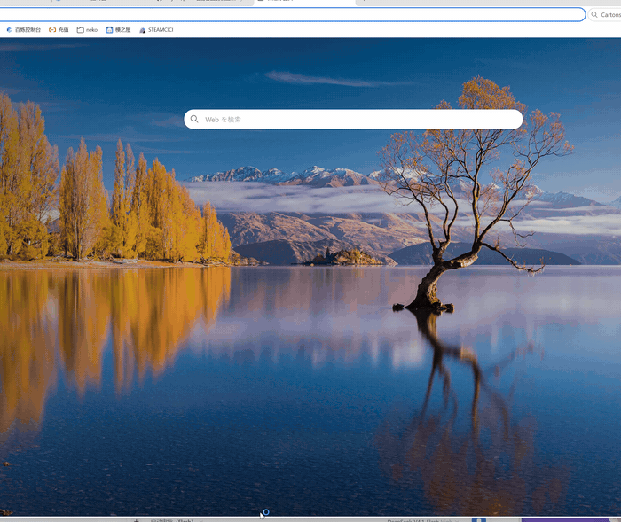

# paw

**A pair of hands for vision models.** Screenshot, click, type, switch windows — every action is one command, and its output goes straight back to the model.



`pc.py` is the whole tool. The model looks at a screenshot and decides what to do; paw moves the mouse and presses the keys.

> Generated by deepseek-V4.1-Flash-1017.

## Why

Most computer-control stacks make you install a framework and grant a pile of permissions before anything moves. paw does one thing: it splits "look at the screen" and "act on the screen" into two commands and lets the model chain them itself.

It works offline. With a cloud model, only the model call needs the network — running everything locally means swapping in a local vision model, which needs more hardware and is slower.

## Quick start

```bash
pip install pyautogui pillow
python pc.py size          # prints screen size; if you see numbers, it works
python pc.py shot s.png    # take a screenshot
python pc.py scale         # prints the display scale (e.g. 1.50x on 150%)
```

## Install

```bash
pip install pyautogui pillow
pip install pygetwindow    # optional: list windows
pip install pywinauto      # optional: virtual desktops
```

Windows, macOS and Linux (X11) all work; on Windows, non-ASCII typing goes through the clipboard.

## Usage

```bash
python pc.py size                        # screen size
python pc.py scale                       # display scale (physical / logical pixels)
python pc.py shot out.png                # screenshot
python pc.py shot out.png --crop 0,0,800,600 --jpg
python pc.py click 960 540               # left click
python pc.py dclick 960 540              # double click
python pc.py rclick 960 540              # right click
python pc.py move 960 540                # move the cursor
python pc.py drag 100 100 900 700        # drag
python pc.py type "hello"                # type text (non-ASCII via clipboard)
python pc.py key enter                   # press a key
python pc.py hotkey ctrl s               # key combination
python pc.py scroll -3                   # scroll (negative = down)
python pc.py focus "Notepad"             # bring a window to the front by title
python pc.py windows                     # list windows
python pc.py launch "steam://open/main"  # open a file, URL or protocol
python pc.py wait 1.5                    # wait
```

Every command prints what it is about to do before doing it, and `--pause <seconds>` sets the delay between actions (default 0.15).

## Steps file

Put one command per line in `steps.txt`, then run:

```bash
python pc.py run steps.txt             # serial
python pc.py run steps.txt --parallel  # parallel for open/look steps, actions stay serial
```

Inline notes after `#` are attached to that step in the action plan:

```
click 960 540   # click the Save button
type "report"   # name the file
```

## Permission levels

| level | meaning |
| --- | --- |
| `browse` | read-only commands (size, shot, windows, scale…) |
| `safe` | default: blocks obviously dangerous actions |
| `full` | everything allowed |

```bash
python pc.py click 960 540 --level safe
```

The emergency stop is pressing left and right mouse buttons at the same time.

## Action plan

Before acting, paw prints a plan like:

```
计划：在 (960, 540) 单击鼠标左键（所在窗口：记事本 - 未命名）
```

Coordinates come with the window title they land on, so you can tell where a click is going to hit.

## Local dashboard

```bash
python serve.py
```

A local page shows each desktop's windows, the foreground window, mouse position and idle seconds, plus an action box (same syntax and permissions), a permission switch and an **emergency stop** button.

## With a vision model

The intended setup is an agent with a **vision-capable model API**: hand it the screenshot and let it decide the next command, instead of computing coordinates yourself.

1. `python pc.py shot screen.png`, send the image to the model;
2. the model tells you where to click and what to type (using screenshot pixel coordinates);
3. `python pc.py click X Y` or `python pc.py type "..."`;
4. repeat.

`shot` and `click` both use physical pixels, so screenshot coordinates work directly. Coordinates estimated from a thumbnail or a chat preview do **not** — run `python pc.py scale` (e.g. at 150% you multiply preview coordinates by 1.5).

## With an agent (MCP)

`paw_mcp.py` is an MCP server that wraps the commands as tools (`screenshot`, `click`, `type_text`, `focus_window`, …). **If your client speaks MCP, you don't change any paw code.**

```bash
pip install "mcp[cli]"
```

Then add a server entry to your client config (adjust the path):

**Claude Desktop** (`claude_desktop_config.json`)

```json
{
  "mcpServers": {
    "paw": {
      "command": "python",
      "args": ["D:/tools/paw/paw_mcp.py"]
    }
  }
}
```

**Cursor** (`.cursor/mcp.json`), **Cline**, **Continue**, **Windsurf**: same idea — `command = python`, `args = ["<path>/paw_mcp.py"]`, stdio transport. The field may be called `mcpServers`, `servers` or `mcp` depending on the client.

Restart the client and you should see 14 tools: `screen_size`, `display_scale`, `screenshot`, `click`, `move`, `drag`, `type_text`, `press_key`, `press_hotkey`, `scroll`, `focus_window`, `list_windows`, `launch`, `wait`.

You can also skip MCP entirely: `SKILL.md` is a plain instruction file for agents that tells them the command table and when to reach for it.

## Risks

- It really moves your mouse and types on your keyboard — use it at your own risk.
- Permission levels, dangerous-word filtering and the emergency stop only block some mistakes; they are not a security guarantee.

## Maintenance

I'm a high-school student, so updates come in bursts — assume "updated irregularly". Bugs, feature ideas and doc fixes are welcome as issues or PRs.

## License

MIT
