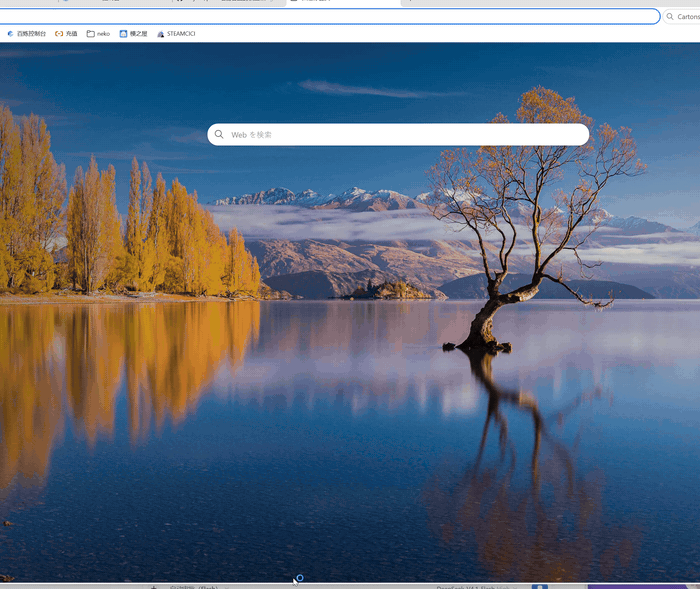
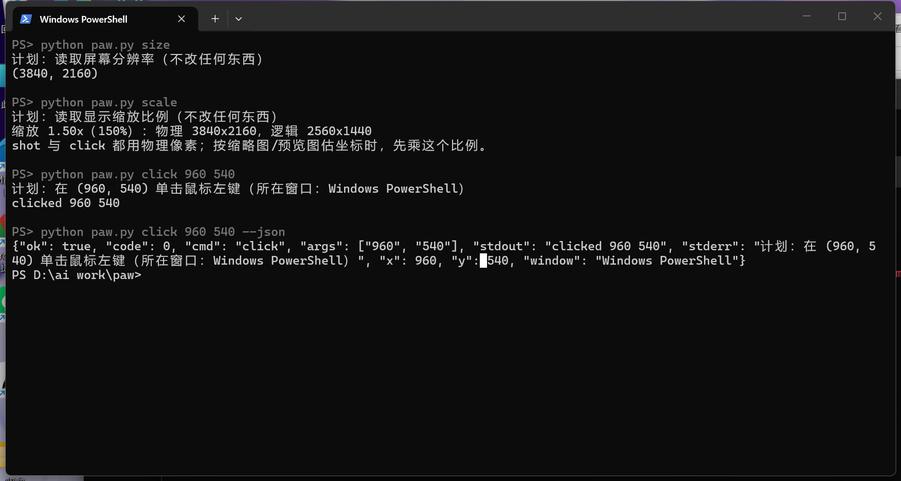
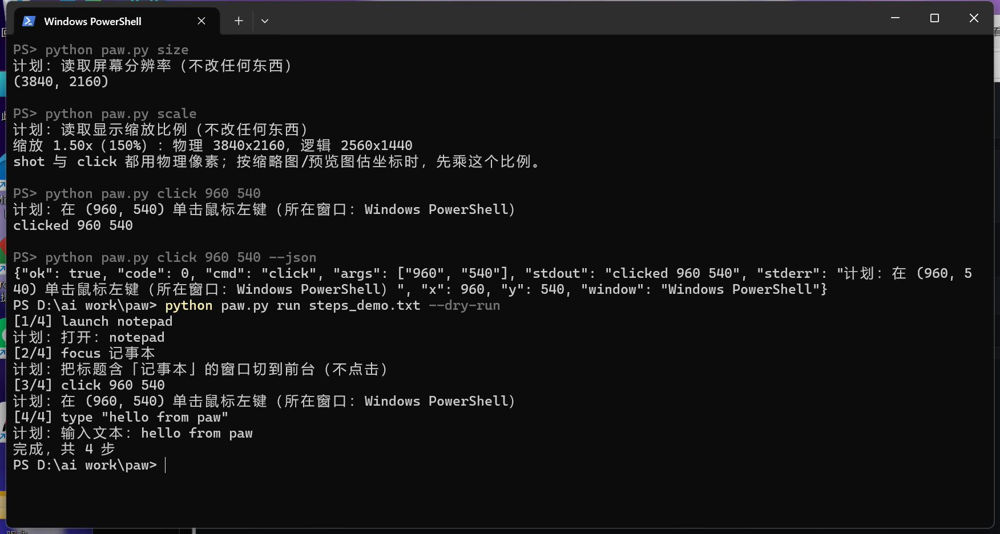
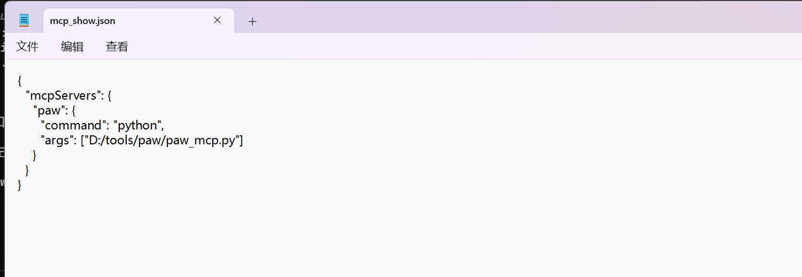

# paw 🐾

[](https://github.com/ahj321/paw/actions/workflows/ci.yml)

**进一步提升 AI 的手：看屏幕、点按钮、打字，全是一条命令的事。**

[English](README.en.md) · 中文



模型负责「看」，paw 负责「动」：截一张图丢给模型，它说点哪儿，`python paw.py click 960 540` 就点下去。

- **零配置**：没有服务要起、没有账号要登、不用申请 key；
- **可离线**：工具本身不联网，只有调模型那一步才需要网；
- **命令行直接用，也能当插件**：agent 拿着命令行就能跑；想挂进 Claude Desktop / Cursor / Cline / Continue，粘一段 MCP 配置就成；
- **看得见**：执行前打印行动表，坐标落在哪个窗口、点在什么按钮上，说得清清楚楚。

> 本项目由 deepseek-V4.1-Flash-1017 生成。

## 为什么写

agent 已经会读代码、写文档，却还差最后三公里：真的替你把那个按钮点下去。这一段通常要装框架、配环境、申请 key——paw 把它压成一条命令：**不额外配 key、不装框架**，`pip install pyautogui pillow` 之后就能动手。

它只做一件事：把「看屏幕」和「动手」拆成两条命令，让模型自己把它们串起来。工具本身离线可用；用云端模型时，只有调用模型这一步需要联网。

## 快速开始

```bash
pip install pyautogui pillow
python paw.py size          # 打印屏幕分辨率，能看到数字就说明装好了
python paw.py shot s.png    # 截一张屏
```

## 长什么样

终端里就是几个数字和一句话。执行前先告诉你「要动什么、动在哪个窗口」：



多步动作写进 `steps.txt`，`run` 会先把每一步的计划列出来，确认了再动：



挂进 agent 只要一段配置：



## 安装

```bash
pip install pyautogui pillow
pip install pygetwindow   # 可选：列窗口
pip install pyvda         # 可选：虚拟桌面
```

Windows / macOS / Linux（X11）可用。Windows 上输入中文走剪贴板。

## 用法

```bash
python paw.py size                        # 屏幕分辨率
python paw.py scale                       # 显示缩放比例（物理 / 逻辑像素换算）
python paw.py shot screen.png             # 截屏
python paw.py click 960 540               # 左键单击
python paw.py dclick 960 540              # 双击
python paw.py rclick 960 540              # 右键
python paw.py move 100 200                # 只移动
python paw.py type "hello world"          # 输入英文
python paw.py type "你好呀"               # 输入中文
python paw.py key enter                   # 按一个键
python paw.py hotkey ctrl s               # 组合键
python paw.py scroll -3                   # 向下滚 3 格
python paw.py find button.png 0.9         # 找图，返回坐标
python paw.py windows                     # 窗口和位置
python paw.py screens                     # 每块桌面开着什么、谁在前台
python paw.py watch 2                     # 实时：现在在干什么
python paw.py desks                       # 虚拟桌面列表
python paw.py desk new                    # 新建桌面
python paw.py desk switch 2               # 切桌面
python paw.py desk close                  # 关闭当前桌面
python paw.py click 960 540 --delay 2     # 动作前等 2 秒
python paw.py run steps.txt               # 跑一串
python paw.py run steps.txt --parallel    # 并行跑打开/查看类步骤
python paw.py run -                       # 从标准输入读
python paw.py uia "记事本"                 # 列出窗口里所有控件和精确坐标
python paw.py uia-click "记事本" "确定"     # 按控件名点击（不用估坐标）
python paw.py start                       # 启动常驻服务（之后每条命令 ~9ms）
python paw.py stop                        # 关掉常驻服务
```

## 按控件点击（uia）

`click x y` 要你先知道坐标。坐标从哪来？截图 + 眼睛估——**估偏几十像素就点空**，尤其是界面缩放、弹窗居中、Qt / Electron 这类自绘界面。

`uia` 换成让 Windows 自己报坐标：

```bash
python paw.py uia "设置"                   # 这个窗口里有哪些控件、各自在哪
python paw.py uia-click "设置" "确定"       # 直接点名叫「确定」的那个
```

输出长这样：

```
窗口：设置  (1290,229)-(3210,1669)
  [PaneControl] '场景' (1290,271)-(1713,1181)
  [ListItemControl] '4K Camera' (1294,1228)-(1708,1273)
```

`uia-click` 走的是 UI Automation 的 Invoke，**不依赖鼠标位置**，也不怕窗口被挡。

## 常驻服务（start / stop）

每次 `python paw.py` 都要重新启动一次 Python（约 150ms），连续点击时这点开销很烦。开个常驻服务就没有了：

```bash
python paw.py start          # 后台起一个服务，默认 8000 端口
python paw.py stop           # 用完关掉
```

起来之后，任何客户端都能通过 HTTP 调它：

```bash
curl -s -X POST http://127.0.0.1:8000/api/action -d "{\"line\":\"click 960 540\"}"
```

也可以直接用附带的 `paw.bat`（Windows 上把目录加进 PATH 后，任何地方都能敲）：

```bat
paw click 960 540
paw type hello
paw shot D:/a.png
paw stop
```

它第一次会顺手把服务起起来，之后每条命令只花几毫秒。

实测（同一条 `size`）：

| 方式 | 耗时 |
|---|---|
| `python paw.py size` | 160 ms |
| `paw.bat size`（服务已在跑） | 服务内 0 ms |
| `curl` 直连服务 | 9 ms |

> 注意：`paw.bat` 只转发、不含 Python；服务没起时它会自动 `paw.py start` 一次。

## steps 文件

`run` 按行执行，每行一条命令，支持引号；`#` 之后是备注，会显示在行动表里，方便你知道这一步在做什么。

```
launch notepad
click 300 200      # 点编辑区，确认光标在文档里
type "hello"
hotkey ctrl s      # 保存
```

## 权限等级

用 `--level`（或环境变量 `PC_LEVEL`）选择，默认 `safe`：

| 等级 | 允许 |
| --- | --- |
| `browse` | 查看与打开：size / shot / windows / find / launch / move |
| `safe` | 再加点击、滚动、打字、按键；命中「付款、注册注销、删改东西」这类词时拒绝 |
| `full` | 全部 |

```bash
python paw.py launch https://bilibili.com --level browse
python paw.py type "确认付款" --level safe   # 被拦截
python paw.py type "确认付款" --level full   # 放行
```

`safe` 按命令和文字关键词判断，只能挡住一部分常见误操作。变体写法、点到几步之后才出现的确认页、业务页面里才看得出的危险操作，都可能拦不住。

## 行动表

每个动作执行前打印一行「计划」，包含三样信息：做什么、落在哪个窗口、以及可选的备注。

```
计划：在 (960, 540) 单击鼠标左键（所在窗口：记事本 - 未命名）  · 点编辑区，确认光标在文档里
```

- 坐标落在哪个窗口，由坐标处最外层窗口的标题给出；
- 备注来自 `steps.txt` 里 `#` 后面的文字。

`--no-plan` 关闭行动表，`--dry-run` 只打印计划、不执行动作。

## 速度

单次调用约 0.2 秒，大头是解释器启动。`click` / `dclick` / `rclick` / `move` / `scroll` / `type` 走系统 API，不再加载 pyautogui；只有 `find`、`watch` 这类确实需要它的命令，才付约 0.4 秒的导入成本。

连续动作写成 steps 文件一次跑完，可以省掉每步的启动开销：

```bash
python paw.py run steps.txt --pause 0.05
```

`--pause` 控制动作之间的间隔，默认 0.15 秒。

## 本地看板（可选）

```bash
python serve.py            # http://127.0.0.1:8000
python serve.py 8765       # 换端口
python serve.py --host 0.0.0.0   # 让局域网能访问
```

目前只有命令行和这个看板两种形态：给 agent 用不需要界面，想盯着看时起 `serve.py`，它和命令行共用同一套动作与权限。

## 在 agent 里用（MCP）

`paw_mcp.py` 是一个 MCP server，把命令包成工具（`screenshot`、`click`、`type_text`、`focus_window`…）。**只要客户端说 MCP，就不用改任何 paw 的代码。**

先装 MCP SDK：

```bash
pip install "mcp[cli]"
```

然后在客户端里加一段配置（路径换成你自己的）：

**Claude Desktop**（`claude_desktop_config.json`）

```json
{
  "mcpServers": {
    "paw": {
      "command": "python",
      "args": ["D:/tools/paw/paw_mcp.py"]
    }
  }
}
```

**Cursor**（`.cursor/mcp.json`，项目或全局）

```json
{
  "mcpServers": {
    "paw": {
      "command": "python",
      "args": ["D:/tools/paw/paw_mcp.py"]
    }
  }
}
```

**Cline / Continue / Windsurf**：同样填 `command = python`、`args = ["<你的路径>/paw_mcp.py"]`，走 stdio。各家字段名可能叫 `mcpServers`、`servers` 或 `mcp`，内容一样。

加完重启客户端，应该能看到 14 个工具：`screen_size`、`display_scale`、`screenshot`、`click`、`move`、`drag`、`type_text`、`press_key`、`press_hotkey`、`scroll`、`focus_window`、`list_windows`、`launch`、`wait`。

不接 MCP 也能用——`SKILL.md` 是给 agent 读的说明书，告诉它命令表和什么时候该动手。

页面上显示每块桌面的窗口、前台窗口、鼠标位置和空闲秒数，提供了一个动作输入框（同一套语法与权限）、权限切换，以及**急停**按钮——点下去后所有动作都被拒绝，再点一次解除。

## 和视觉模型一起用

建议接一个**带视觉能力的模型 API 的 agent**：把截图交给它，让它自己决定下一步调用哪条命令，你不必手动算坐标。

1. `python paw.py shot screen.png`，把图发给模型；
2. 模型告诉你点哪里、输入什么（坐标用截图的像素坐标）；
3. `python paw.py click X Y` 或 `python paw.py type "..."`；
4. 重复。

`shot` 和 `click` 都用物理像素，截图坐标可以直接用。要注意的是**按缩略图、聊天里预览图估出来的坐标不能直接用**——`python paw.py scale` 会打印当前缩放比（例如 150% 时，预览图上的坐标要乘 1.5 才是截图坐标）。

## 常见问题

**点了没反应？**
先确认目标窗口在前台：`python paw.py focus "记事本"`，再点。第一下点击常常只是激活窗口，第二下才落在按钮上。

**点偏了十几像素？**
`python paw.py scale` 看一眼缩放比例。Windows 150% 缩放下，截图坐标是物理像素，从预览图上量的要乘 1.5。

**无边框全屏的游戏截出来是黑的？**
系统级截屏拿不到某些独占全屏画面。改成窗口化或无边框窗口模式就能截到。

**中文打不进去？**
`type` 走剪贴板（先备份、粘完还原）。如果别的程序正占着剪贴板，会失败——重试一次通常就好。

**多显示器怎么点第二块屏？**
`python paw.py screens` 打印每块屏的原点和尺寸，第二块屏的坐标从它的原点算起（可能是负数）。先在目标屏上 `shot` 确认一次。

## 风险

- 它会真的移动你的鼠标、敲你的键盘，请自行承担后果。
- 权限分级、危险词拦截、急停只能挡住部分误操作，不构成安全保证。

## 维护

我是高一学生，课业紧的时候会停更一段时间，请按「不定期更新」来预期。发现 bug、想加功能，或文档哪里不清楚，欢迎开 issue 或提 PR。

### 测试

```bash
pip install pytest
pytest -q          # 11 个测试，0.2 秒跑完
```

测的都是**不碰鼠标键盘**的纯逻辑：命令与参数解析、三档权限矩阵、危险词拦截、`steps.txt` 的解析（注释、空行、行内备注）、每个命令是否都登记了权限等级。

每次 push 和 PR，GitHub Actions 会在 **Windows runner 上跑 Python 3.9 与 3.12 两遍**，再顺手 `python -m build` 确认打包没坏——三条都绿了才算过。

真正「点一下鼠标」的那部分没法在无头环境测，所以它的正确性靠**行动表 + 你自己先看一眼**，而不是靠自动测试。

## License

MIT

---

版本 **v1.3**，更新记录见 [CHANGELOG.md](CHANGELOG.md)。
